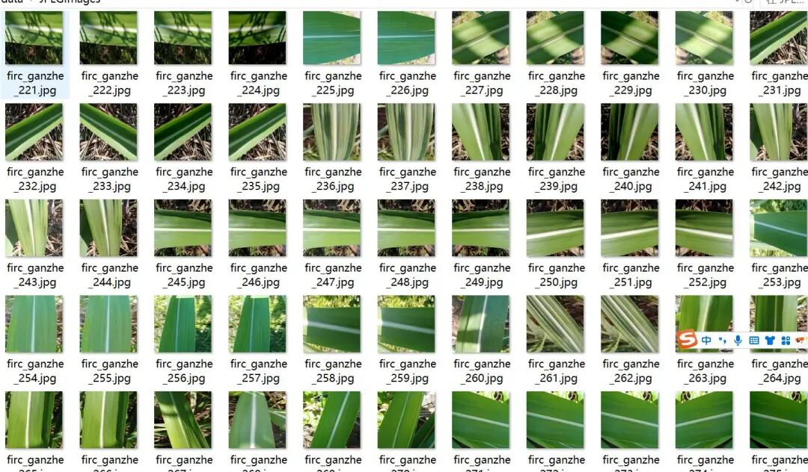
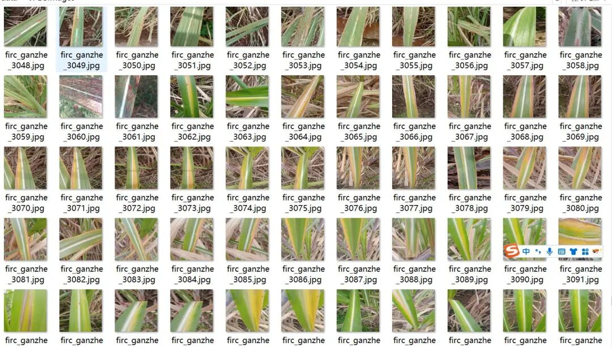
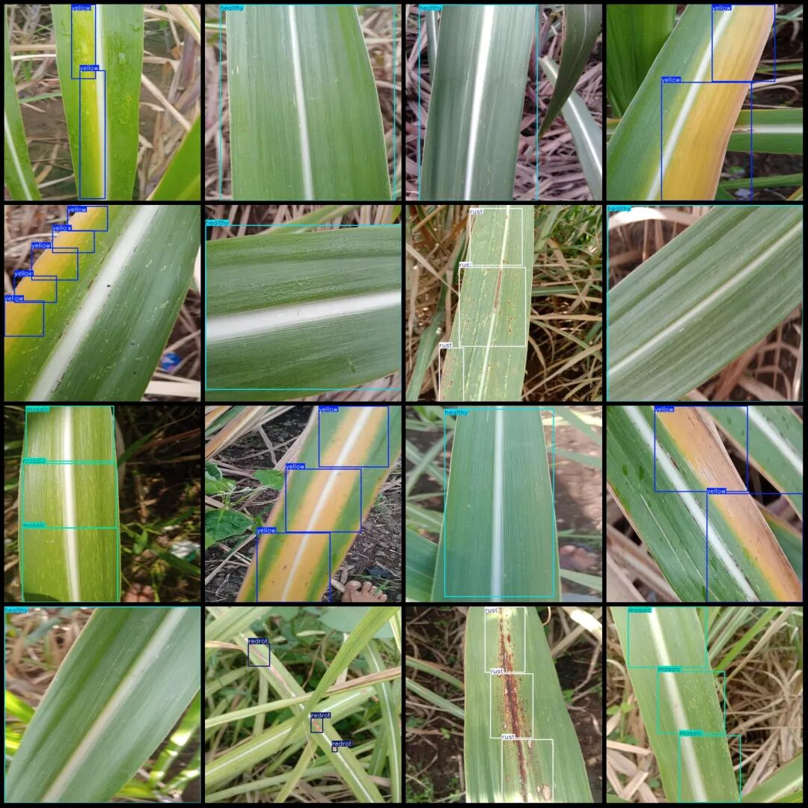

# Sugarcane Leaf Disease Detection Dataset VOC+YOLO format with 3582 images in 5 categories

Please note that the images are taken close to the leaves, and for specific details, please refer to the preview.

Dataset format: Pascal VOC format + YOLO format (txt file without split path, only containing jpg images and corresponding VOC format xml files and yolo format txt files)

Number of images (number of jpg files): 3582

Number of annotations (number of xml files): 3582

Number of annotations (number of txt files): 3582

Label category count: 5

Image resolution: 640x640

Label category names (note that the order of categories in the YOLO format does not correspond to this, but is based on the classes.txt file in the labels folder): ["healthy", "mosaic", "redrot", "rust", "yellow"]

Number of boxes labeled in each category:

Healthy Frames = 1324

Number of mosaic frames = 1910

RedRot Frame Count = 498

Rust frame count = 2658

Yellow box count = 2688

Total frame count: 9078

Using labelImg:

Annotation rules: Draw a rectangle around the category.

Important Notice: No

Special : This dataset does not guarantee the accuracy of the trained models or weight files.

Image Preview:

Annotation example:

## Payment

Here is a pay link on Stripe ( https://buy.stripe.com/3cs8yP7sY87d0vu9AB ). Please contact me lonlonago@foxmail.com after funding $89, and I will send you a complete data files , thank you!

